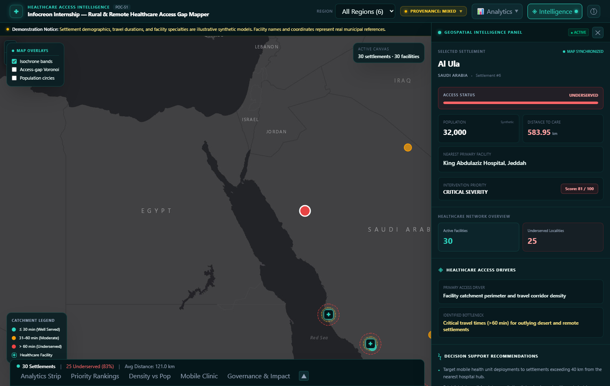
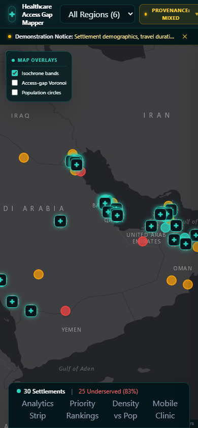
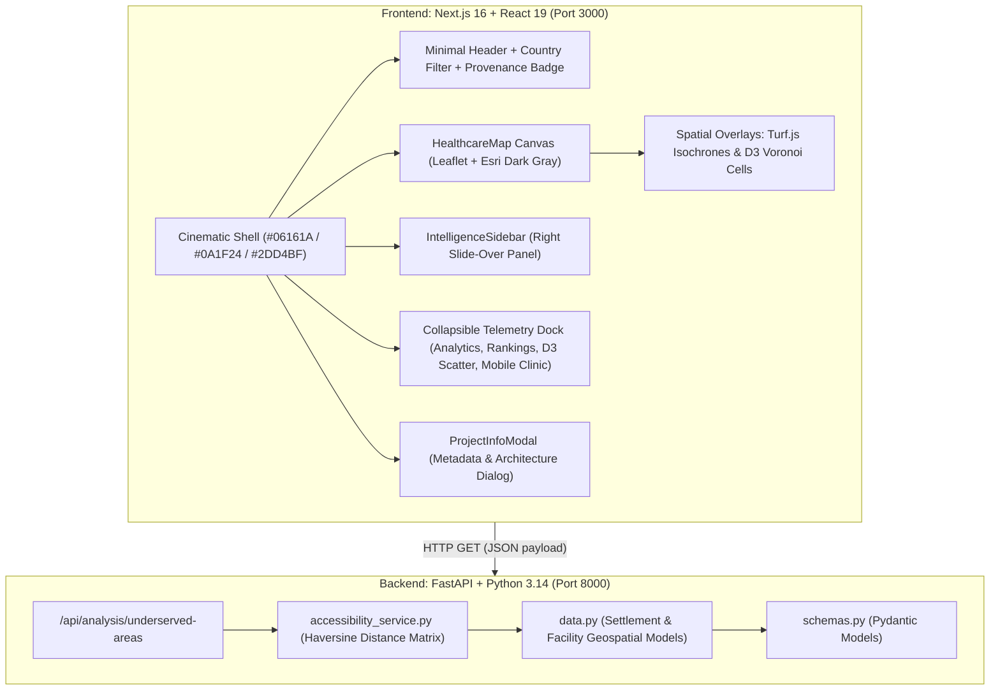

# Rural & Remote Healthcare Access Gap Mapper

[](#project-overview)
[](#project-overview)
[](https://github.com/Er-ine)
[-black.svg)](https://nextjs.org/)
[-009688.svg)](https://fastapi.tiangolo.com/)

An operational geospatial decision-intelligence platform engineered to identify, analyze, and visualize healthcare accessibility disparities facing rural and remote settlements across Gulf Cooperation Council (GCC) nations (Oman, Saudi Arabia, UAE, Qatar, Bahrain, Kuwait).

---

## Visual Preview

| Full-Screen Intelligence Canvas | Settlement Inspection Slide-Over |
| :---: | :---: |
|  |  |
| *Full-viewport map canvas, Esri dark tiles, and bottom telemetry dock* | *Deep-dive settlement accessibility profile, severity score, and travel metrics* |

| System Information Modal | Responsive Mobile View |
| :---: | :---: |
|  |  |
| *Verified system metadata, technical specifications, and architect identity* | *Adaptive layout tested on mobile (390×844) viewport* |

---

## Project Overview

- **Project Title:** Rural & Remote Healthcare Access Gap Mapper
- **Program:** Infocreon Internship — Batch 6
- **POC ID:** 51
- **Architect & Lead Engineer:** Erine Anna Binu ([@Er-ine](https://github.com/Er-ine))
- **Primary Domain:** Healthcare Equity, Spatial Catchment Analytics, Decision Support Systems

Healthcare infrastructure across the Arabian Gulf has historically concentrated in high-density metropolitan and coastal zones. Rural and desert interior settlements often experience significant travel burdens to secondary, tertiary, and emergency care facilities.

This platform bridges this critical intelligence gap by coupling settlement geolocations with healthcare facility coordinates, evaluating distance horizons using the geodesic Haversine model, and generating interactive spatial isochrones, Voronoi access territories, priority ranking matrices, and mobile health clinic dispatch sequences.

---

## Problem Statement

Rural and remote populations face compounding obstacles when accessing essential clinical care:
1. **Critical Travel Horizons**: Settlements situated beyond 15 km (or 30–60 minutes) experience delayed acute emergency care, heightened maternal/perinatal risk, and lower preventive health screening compliance.
2. **Resource Misallocation**: Uniform healthcare resource allocation often overlooks remote clusters with high population density but extreme facility travel distances.
3. **Operational Visibility Gaps**: Healthcare planners require dynamic, spatial tools rather than static spreadsheets to simulate facility catchments, identify isolated populations, and plan mobile clinic routing efficiently.

---

## System Architecture

The application adopts a decoupled, high-performance architecture optimized for geospatial intelligence workflows:



### Key Architectural Layers
1. **Presentation & Cartography Layer**:
   - Next.js 16 with Turbopack and React 19 Client Components.
   - Esri World Dark Gray Canvas tile service: dark, reliable, and free without requiring API keys or exposing credentials.
   - Custom Glowing Medical Pins: Leaflet `divIcon` with teal glowing medical cross emblems (`✚`).
   - Smooth slide-over drawer navigation and keyboard-accessible modal dialogs.
2. **Analytical Layer**:
   - D3.js: Voronoi geometric cell shading representing nearest-neighbor access perimeters; facility density vs. population regression matrix.
   - Turf.js: Geodesic multi-ring spatial isochrone catchment buffers (30 min / 20 km, 60 min / 40 km, 90 min / 60 km).
3. **Calculation & Data Engine**:
   - FastAPI REST service computing pairwise geodesic coordinates using the spherical Haversine formula.
   - Classifies accessibility into **Well Served** (&le;5 km), **Moderate Access** (5–15 km), and **Underserved** (&gt;15 km).
   - Priority severity scoring algorithm integrating travel distance (60% weight) and affected population (40% weight).

---

## Verified Tech Stack

| Layer | Technology | Version | Purpose |
| :--- | :--- | :--- | :--- |
| **Frontend Framework** | Next.js (App Router, Turbopack) | `16.3.2` | Core web application shell & server rendering |
| **UI Runtime** | React & React DOM | `19.2.8` | Component lifecycle & reactive state tree |
| **Styling Engine** | Tailwind CSS & `@tailwindcss/postcss` | `^4.0.0` | Cinematic dark theme tokens & responsive utilities |
| **Mapping Library** | Leaflet | `1.9.4` | Interactive slippy map engine |
| **React Map Binding** | React-Leaflet | `5.0.0` | Declarative map component bindings |
| **Tile Provider** | Esri World Dark Gray Canvas | REST Service | Watermark-free, dark cartographic basemap |
| **Spatial Geometry** | Turf.js (`@turf/turf`) | `7.4.0` | Multi-ring circular catchment isochrones |
| **Data Visualization** | D3.js (`d3`) & `@types/d3` | `7.9.0` | Voronoi tessellation & density scatter plots |
| **Backend Framework** | FastAPI | `0.135.2` | High-performance asynchronous REST API |
| **ASGI Web Server** | Uvicorn (`uvicorn[standard]`) | `0.42.0` | Production ASGI HTTP server |
| **Data Validation** | Pydantic | `2.12.5` | Strict schema validation and data serialization |
| **Language Runtime** | Python | `3.14.4` | Spatial calculations & Haversine distance engine |
| **Language Runtime** | TypeScript | `^5.0.0` | Strict type safety across the frontend |

---

## Installation & Running Locally

### Prerequisites
- **Node.js**: v20.x or higher
- **npm**: v10.x or higher
- **Python**: v3.10 or higher

### 1. Clone the Repository
```bash
git clone https://github.com/Er-ine/-POC--51--rural-remote-healthcare-access-mapper--Erine-Anna-Binu.git
cd -POC--51--rural-remote-healthcare-access-mapper--Erine-Anna-Binu
git checkout cinematic-rail
```

### 2. Backend Setup & Startup
Open a terminal in the root directory:
```bash
cd backend

# (Optional) Create and activate a virtual environment
python -m venv .venv
# Windows:
.venv\Scripts\activate
# Linux/macOS:
# source .venv/bin/activate

# Install required backend dependencies
pip install fastapi "uvicorn[standard]" pydantic

# Launch the FastAPI application
python -m uvicorn app.main:app --port 8000
```
Backend API will be live at `http://127.0.0.1:8000`. Verify by opening `http://127.0.0.1:8000/health`.

### 3. Frontend Setup & Startup
In a separate terminal:
```bash
cd frontend

# Install dependencies
npm install

# Start development server
npm run dev
```
Open `http://localhost:3000` in your browser.

To verify a production build:
```bash
cd frontend
npm run build
npm run start -- -p 3000
```

---

## API Documentation

### 1. Health Check
- **Endpoint:** `GET /health`
- **Description:** Verifies service availability.
- **Response (`200 OK`):**
  ```json
  {
    "status": "ok",
    "service": "poc51-healthcare-access-mapper"
  }
  ```

### 2. Spatial Accessibility Analysis
- **Endpoint:** `GET /api/analysis/underserved-areas`
- **Description:** Evaluates all settlements against national healthcare facilities, computing Haversine distance matrices, nearest facilities, and categorization statuses.
- **Response (`200 OK`):**
  ```json
  {
    "total_settlements": 30,
    "total_facilities": 30,
    "underserved_count": 25,
    "underserved_areas": [
      {
        "settlement_id": 6,
        "settlement_name": "Al Ula",
        "country": "Saudi Arabia",
        "population": 32000,
        "nearest_facility": "King Abdulaziz Hospital, Jeddah",
        "distance_km": 583.95,
        "accessibility_status": "Underserved"
      }
    ],
    "all_results": [ ... ]
  }
  ```

---

## Data Provenance & Synthetic Data Transparency

Per Section 9 of the engineering specification, data transparency is strictly enforced:
- **Real-Based Facility Data**: Hospital names and coordinates are based on publicly known healthcare institutions across the Gulf (e.g., Royal Hospital Muscat, Sultan Qaboos Hospital Salalah, King Fahad Medical City Riyadh). Centroids represent city-level approximations.
- **Synthetic Demographic & Operational Data**: Settlement population figures, travel durations, facility capacities (bed counts), and specialized clinic rosters are **synthetic illustrative models** designed to demonstrate the catchment and prioritization algorithms. They do not represent verified census or ministry records.
- **Transparency Controls**:
  - A prominent, dismissible **Demonstration Notice** is displayed below the header.
  - The **Provenance Badge** (`DataStatusBadge`) details exact data boundaries.
  - Metrics in the slide-over panel and tables are clearly flagged with `(Synthetic)` and `(Illustrative)` indicators.

---

## Verification & Testing Summary

Every component, route, and command has been verified against the actual repository:

| Verification Target | Test Performed | Result | Details |
| :--- | :--- | :--- | :--- |
| **Frontend Code Quality** | `npm run lint` (ESLint 9) | **PASSED** | 0 errors, 0 warnings across all `.ts` and `.tsx` files |
| **TypeScript Compilation** | `npm run build` (Turbopack) | **PASSED** | Type-checked successfully with 0 errors |
| **Production Build** | `next build` | **PASSED** | Static pages generated in 943ms |
| **Backend Startup** | `uvicorn app.main:app --port 8000` | **PASSED** | Server started on port 8000 |
| **Backend Health Endpoint** | `Invoke-RestMethod /health` | **PASSED** | Returned HTTP 200 `status: ok` |
| **Backend Analysis Endpoint** | `Invoke-RestMethod /api/analysis/underserved-areas` | **PASSED** | Returned HTTP 200 with 30 settlements and 25 underserved localities |
| **Frontend Live Serving** | `Invoke-WebRequest http://localhost:3000` | **PASSED** | Returned HTTP 200 OK |
| **Browser UI Validation** | Headless Edge via Puppeteer | **PASSED** | Verified map, slide-over panel, modal, and mobile responsiveness |
| **Remote Git Push** | `git push origin cinematic-rail` | **NOT TESTED** | Intentionally omitted per instructions |

---

## Verified Screenshots

Screenshots were captured from the live application running on Edge:
1. [`screenshots/1_fullscreen_map_panel_closed.png`](screenshots/1_fullscreen_map_panel_closed.png): Full-screen map with closed intelligence panel and bottom analytics dock.
2. [`screenshots/2_map_intelligence_panel_open.png`](screenshots/2_map_intelligence_panel_open.png): Slide-over intelligence panel open, inspecting Al Ula (583.95 km gap, Critical Severity).
3. [`screenshots/3_project_information_modal.png`](screenshots/3_project_information_modal.png): Project metadata and architecture modal dialog.
4. [`screenshots/4_mobile_viewport.png`](screenshots/4_mobile_viewport.png): Mobile-optimized interface (390×844) with non-overlapping notice sub-bar.

---

## Future Improvements

1. **Road-Network Isochrones**: Integrate OSRM, OpenRouteService, or GraphHopper to compute route-distance and terrain-adjusted drive times instead of geodesic radius bands.
2. **Constrained Mobile Clinic VRP**: Upgrade the current farthest-first heuristic into a multi-stop Capacitated Vehicle Routing Problem (CVRP) solver accounting for crew rest hours and vehicle range.
3. **Official Census Integration**: Ingest verified national spatial data infrastructure (NSDI) and census datasets when authorized data feeds become accessible.
4. **Offline Spatial Caching**: Implement Service Worker vector tile caching for disconnected field workers in remote desert clinics.

---

## Repository & Branch Reference

- **Active Development Branch:** `cinematic-rail`
- **Main Branch:** `main` (Untouched)
- **Primary Architect:** Erine Anna Binu ([@Er-ine](https://github.com/Er-ine))
